# 基于 SpringBoot + Vue + 小程序的智慧停车场管理系统的设计与实现

> 本文围绕基于 SpringBoot、Vue、小程序技术栈的智慧停车场管理系统，详细阐述了系统从项目背景、功能模块、技术栈到核心业务流程的设计与实现过程，旨在提高停车场管理效率，优化车主停车体验。

## 一、项目背景

随着城市化进程的加快，车辆保有量不断增长，传统停车场管理方式面临着入场效率低、出场缴费慢、车位信息不透明等问题。为了解决这些问题，设计并实现了一套基于移动互联网技术的智慧停车场管理系统。该系统通过小程序为车主提供便捷的车辆入场、出场、缴费及车位查询等服务，同时通过物业管理端为物业人员提供高效的业主信息、车位、车辆及出入场记录管理功能，从而提升停车场整体的运营效率和管理水平。

## 二、功能模块介绍

本系统分为两个主要的客户端：用户端（小程序）和物业管理端（网页）。

| 所属端 | 角色 |
| :--- | :--- |
| 用户端 | 车主 |
| 物业管理端 | 管理员 |

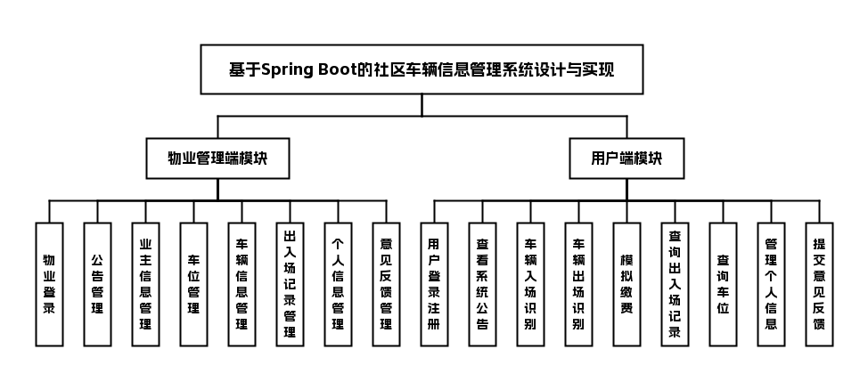

## 三、技术栈说明

前端：Vue（物业管理端网页）、小程序（用户端）

后端：Java、SpringBoot

数据库与中间件：MySQL

## 四、核心模块介绍

###### 用户端

###### 车主

| 功能模块 | 功能描述 |
| :--- | :--- |
| 用户登录注册 | 支持车主通过手机号等方式进行注册和登录 |
| 首页 | 展示系统公告信息 |
| 车辆入场 | 支持输入或识别车牌号，包括外来车辆 |
| 车辆出场 | 支持输入或识别车牌号，包括外来车辆 |
| 模拟缴费 | 提供模拟的缴费功能 |
| 出入场记录 | 查看历史入场和出场记录 |
| 车位查询 | 查询当前停车场可用车位信息 |
| 个人信息 | 管理基本资料、修改密码、绑定个人车辆的车牌 |
| 意见反馈 | 向物业提交意见或建议 |

##### 界面展示

注册页：填写注册信息，完成社区车辆管理小程序注册

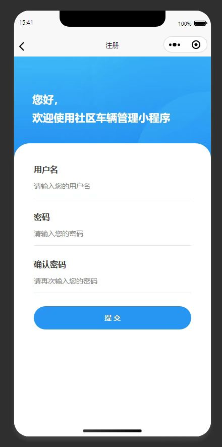

登录页：输入账号密码，登录社区车辆管理小程序

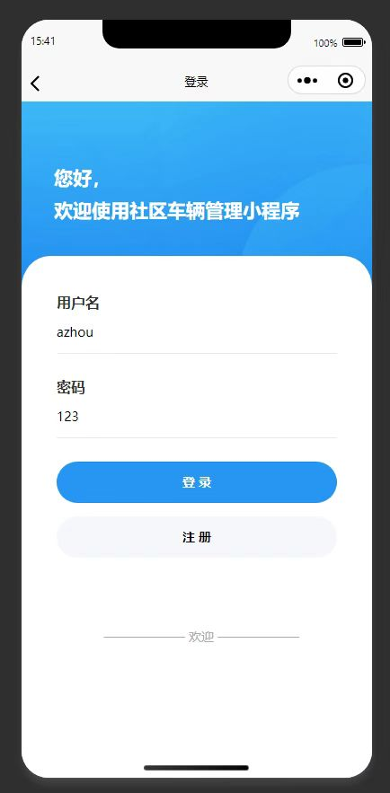

首页：提供车辆出入场入口，展示停车收费标准

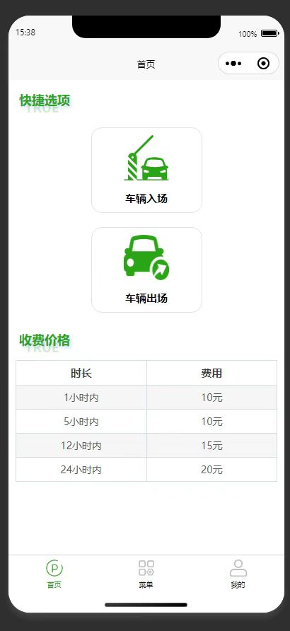

菜单页：提供各类停车相关功能的快捷入口

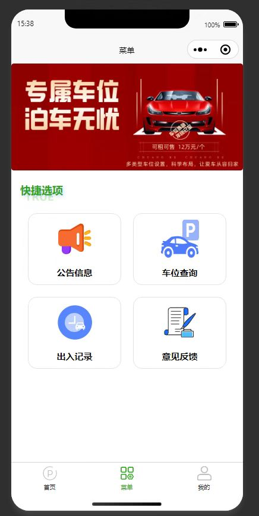

公告列表页：展示社区各类公告，供用户查看

公告详情页：查看社区发布的秋季运动会公告详情

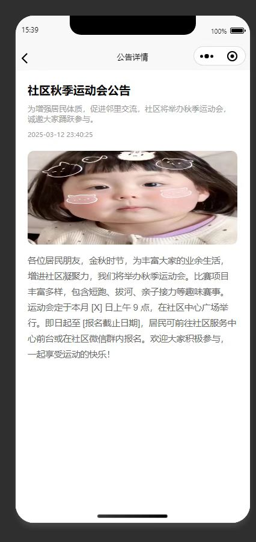

车位查询页：查看所有车位的编号和当前空闲状态

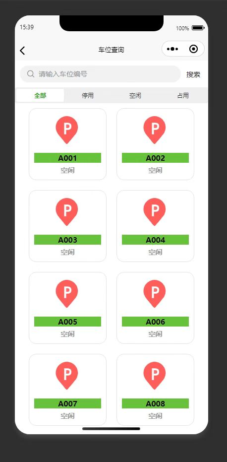

出入场记录页：展示车辆停车出入场历史记录，支持搜索查询

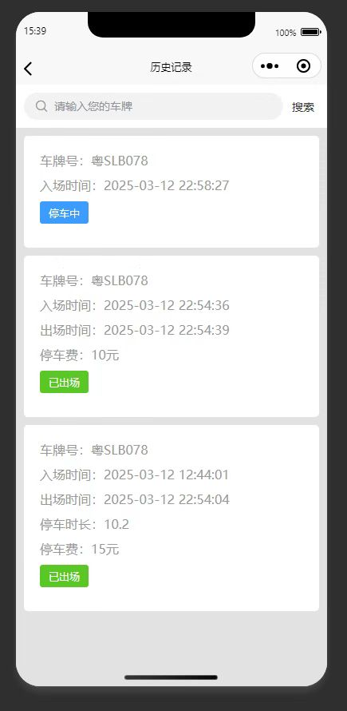

模拟缴费页：展示车辆出场信息，待用户缴纳停车费用

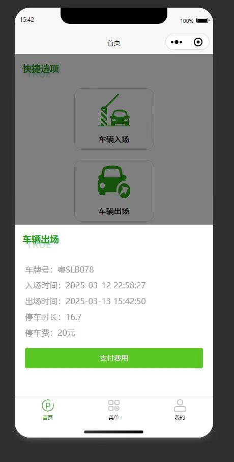

意见反馈列表页：查看已提交的意见反馈及处理结果

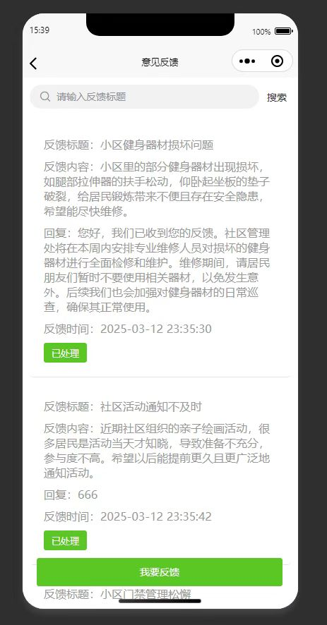

个人中心页：展示个人中心快捷功能，管理个人及车辆信息

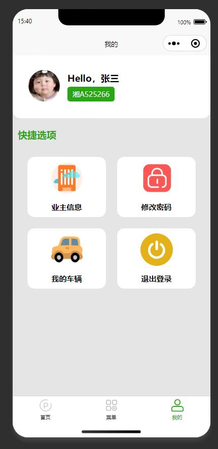

个人信息修改页：修改个人信息，修改完成后提交更新

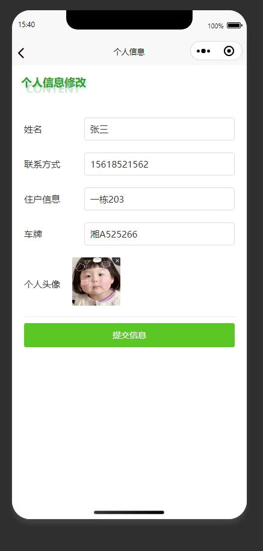

密码修改页：用户在此修改个人账户的登录密码

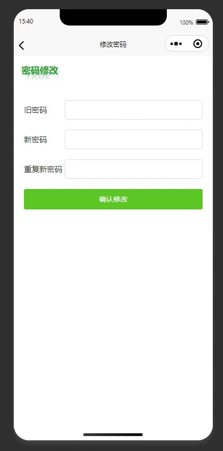

车辆管理页：管理个人已绑定车辆，支持新增删除设置常用车

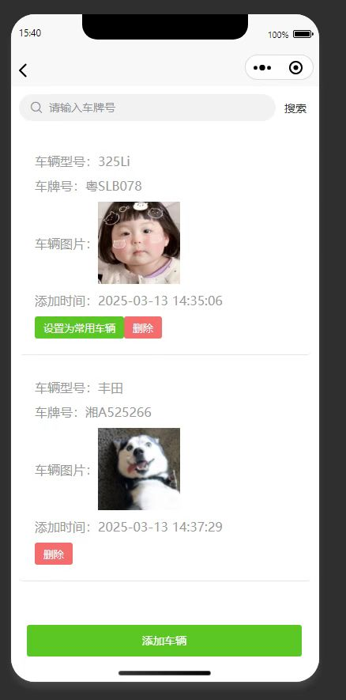

###### 物业管理端

###### 管理员

| 功能模块 | 功能描述 |
| :--- | :--- |
| 物业登录 | 内部物业人员登录系统，无需注册 |
| 公告管理 | 发布、编辑、删除系统公告 |
| 业主信息管理 | 管理业主的姓名、电话、住户信息及车牌 |
| 车位管理 | 管理停车场车位信息 |
| 车辆信息管理 | 管理车辆的基本信息 |
| 出入场记录管理 | 管理由入场、出场、缴费组成的完整记录 |
| 个人信息 | 管理管理员的基本资料和密码 |
| 意见反馈管理 | 查看和处理车主提交的意见反馈 |

##### 界面展示

登录页：输入账号密码，登录社区车辆管理系统

公告管理页：管理社区公告，支持增删改查搜索操作

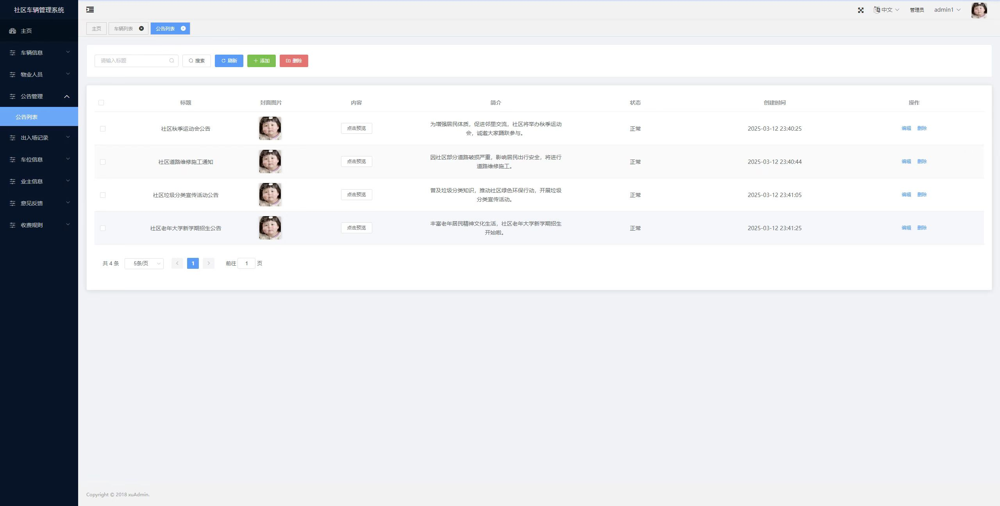

公告编辑页：对已有的社区公告进行修改编辑

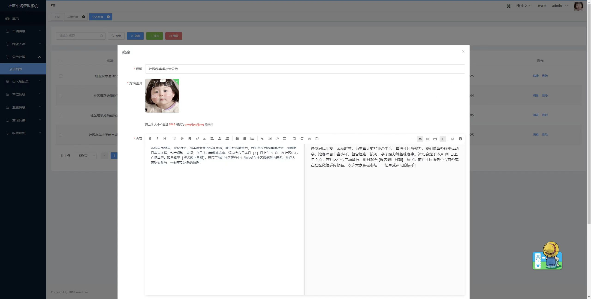

业主信息管理页：管理业主信息，支持搜索增删改操作

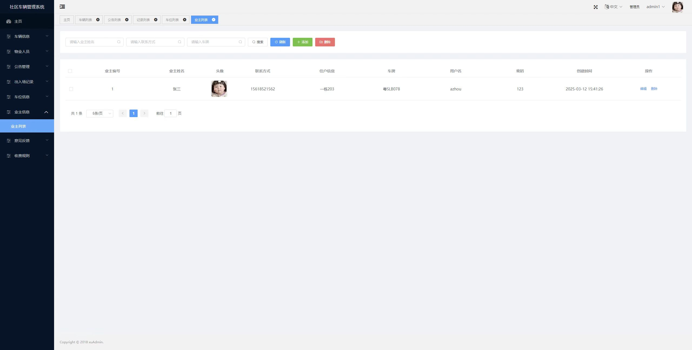

车辆信息管理页：管理小区车辆信息，支持搜索增删改操作

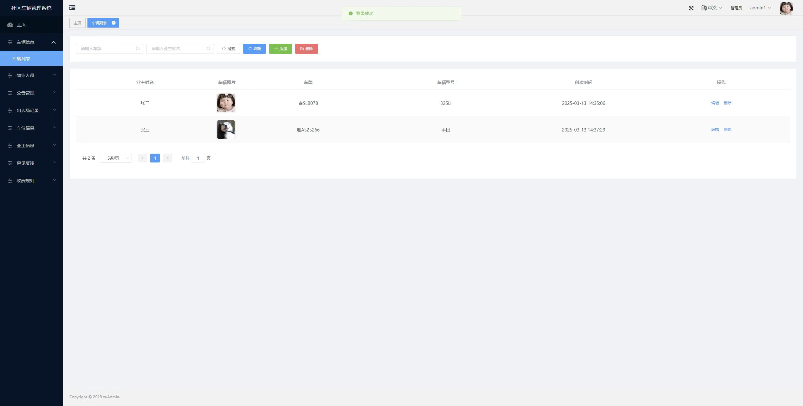

车位管理：查看并管理系统内所有车位信息

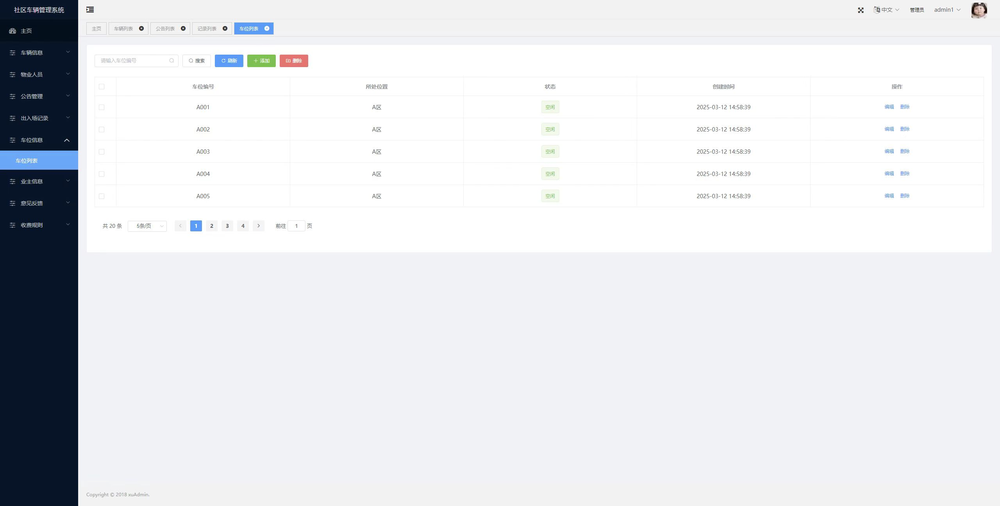

出入场记录管理：查看并管理车辆出入场的停车记录

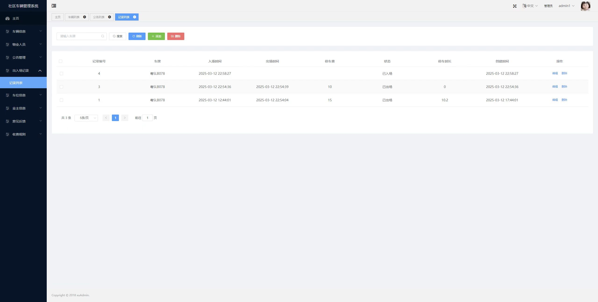

收费规则管理：管理社区停车收费规则，支持增删改查操作

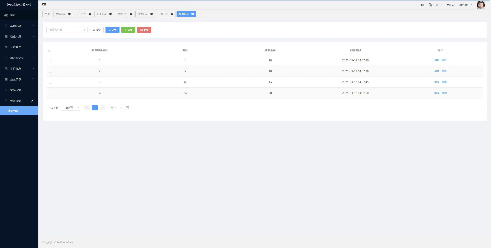

意见反馈管理页：查看并处理业主提交的意见反馈

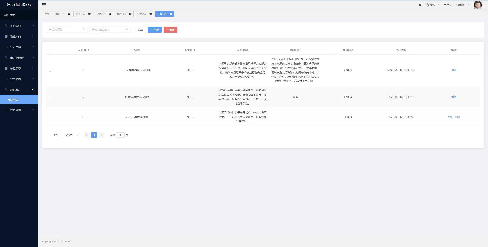

## 五、主要业务流程

1. 车主打开小程序，进行登录或注册。
2. 车主到达停车场入口，通过小程序输入或扫描识别车牌号，完成车辆入场操作。
3. 系统记录入场信息，并更新车位状态为已占用。
4. 车主在停车场内可通过小程序查询可用车位。
5. 车主准备离开时，通过小程序发起车辆出场请求。
6. 系统计算停车时长及费用，车主进行模拟缴费。
7. 车主完成缴费后，系统记录出场信息，更新车位状态为空闲，并生成一条完整的出入场记录。
8. 物业管理员通过网页端登录系统，管理业主信息、车位、车辆及审核出入场记录和意见反馈。

## 六、项目拓展性

- **第三方支付集成**：可将模拟缴费功能对接真实第三方支付接口，实现线上真实缴费。
- **车牌自动识别**：可集成硬件摄像头与车牌识别算法，实现无感入场与出场。
- **智能车位引导**：结合车位传感器与显示大屏，实现车位级引导功能。
- **数据分析与报表**：可增加数据统计模块，为物业提供车位利用率、车流量等运营报表。

## 代码说明 
本仓库为项目的 **后端核心代码部分** 主要用于展示系统的业务设计思路与后端实现方式 出于学习展示与版权保护考虑 前端实现、完整数据库脚本及部署配置未在本仓库中公开 

##  项目交流 
本项目用于学习展示 如需项目完整功能演示、答辩说明或技术交流 请前往作者 GitHub 主页查看联系方式